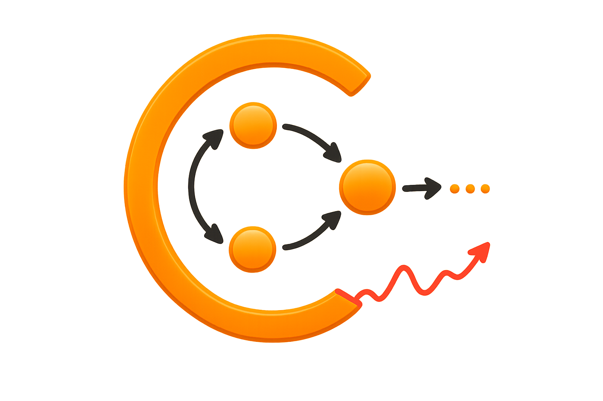

---
myst:
  html_meta:
    "description": "Causal-TS is a Python library for causal discovery (causal structure learning) in stationary and nonstationary multivariate time series: constraint-based (CDNOTS, CDNOTS+, CEDAR), score-based (LGES, TGES, GES) and hybrid (GRACE, REAP) methods, CPU and GPU conditional-independence tests, LUCID latent-confounder correction and DoWhy effect estimation."
    "google-site-verification": "B1Vaoes-7BZBNEdL2FxoOcN4tFdqkJJAhCxmVv5qR_Q"
    "property=og:title": "Causal-TS: causal discovery for time series in Python"
    "property=og:image": "https://causal-ts.readthedocs.io/en/latest/_static/img/social_preview.png"
    "property=og:image:alt": "Causal-TS: causal discovery for time series in Python"
    "name=twitter:card": "summary_large_image"
---

```{toctree}
:hidden:
:maxdepth: 2

getting_started/index
algorithms
ci_tests
examples/index
api/index
cli
```

<div class="ct-hero">
  <div class="ct-hero-inner">
    
    <div class="ct-hero-text">
      <div class="ct-brand" role="presentation">Causal-<span class="ct-logo-ts">TS</span></div>
      <p class="tagline">
        Causal discovery for stationary and nonstationary time series.<br/>
        Constraint-based, score-based and hybrid discovery · linear and nonlinear CI tests · effect estimation.
      </p>
      <div class="btn-group">
        <a href="getting_started/index.html" class="ct-btn ct-btn-primary">Get Started</a>
        <a href="examples/index.html" class="ct-btn ct-btn-secondary">Examples</a>
        <a href="api/index.html" class="ct-btn ct-btn-secondary">API Reference</a>
      </div>
    </div>
  </div>
</div>

<div class="ct-stats-strip">
  <div class="ct-stat">
    <span class="ct-stat-num">11</span>
    <span class="ct-stat-label">Algorithms</span>
  </div>
  <div class="ct-stat-div"></div>
  <div class="ct-stat">
    <span class="ct-stat-num">19</span>
    <span class="ct-stat-label">CI Tests</span>
  </div>
  <div class="ct-stat-div"></div>
  <div class="ct-stat">
    <span class="ct-stat-num">GPU</span>
    <span class="ct-stat-label">or CPU</span>
  </div>
  <div class="ct-stat-div"></div>
  <div class="ct-stat">
    <span class="ct-stat-num">+</span>
    <span class="ct-stat-label">Causal Inference</span>
  </div>
</div>

# Causal discovery for time series in Python

Causal-TS (`causalts` on PyPI) is an open-source Python library for causal
discovery (also called causal structure learning) from stationary and
nonstationary multivariate time series. It learns lagged and contemporaneous causal graphs
with constraint-based, score-based and hybrid methods;
provides linear and nonlinear conditional-independence tests on CPU and GPU;
and supports graph refinement, regime discovery, latent-confounder correction,
missing and mixed data, and optional causal effect estimation and
counterfactual analysis through DoWhy.

## Discovery Algorithms

::::{grid} 1 2 2 2
:gutter: 3

:::{grid-item-card} {fas}`circle-nodes;1.2em;sd-text-primary` &nbsp; CDNOTS · CDNOTS+
:link: algorithms
:link-type: doc
:shadow: md
:class-header: sd-bg-primary sd-text-white

**Constraint-based**
^^^
Extends PC to time series with one or more **C** nonstationarity nodes: skeleton discovery → collider and Meek orientation → nonstationarity-based orientation. **CDNOTS+** re-tests the skeleton with PCMCI+-style MCI conditioning (only on discovered parents, avoiding over-conditioning on dense graphs), with opt-in LiNGAM orientation of contemporaneous edges.

+++
{bdg-primary-line}`nonstationary` {bdg-secondary-line}`any CI test` {bdg-light}`CDNOTS+`
:::

:::{grid-item-card} {fas}`shuffle;1.2em;sd-text-primary` &nbsp; CEDAR
:link: algorithms
:link-type: doc
:shadow: md
:class-header: sd-bg-primary sd-text-white

**Autoregressive · Pairwise**
^^^
Causal Edge Discovery for Autoregressive processes. Per-pair minimum-lag selection (partial distance correlation by default), two CI tests per candidate edge, then MCI pruning. Supports the C node and single-target discovery. Assumes an autoregressive design.

+++
{bdg-light}`O(d²)` {bdg-primary-line}`AR processes` {bdg-secondary-line}`single target`
:::

:::{grid-item-card} {fas}`code-merge;1.2em;sd-text-primary` &nbsp; GRACE · REAP
:link: algorithms
:link-type: doc
:shadow: md
:class-header: sd-bg-primary sd-text-white

**Hybrid · grow-shrink refinement**
^^^
Refine the lagged edges of a directed candidate graph (CDNOTS by default, or any method's graph): a shrink step prunes, then grow rounds add missed lagged parents. **GRACE** prunes with neural L0 gates and can keep parents that change only a target's noise scale; **REAP** prunes by regression (partial F-tests), with no training.

+++
{bdg-light}`any candidate graph` {bdg-primary-line}`gates (GRACE)` {bdg-secondary-line}`regression (REAP)`
:::

:::{grid-item-card} {fas}`scale-balanced;1.2em;sd-text-primary` &nbsp; LGES · GES · Lasso-VAR
:link: algorithms
:link-type: doc
:shadow: md
:class-header: sd-bg-primary sd-text-white

**Score-based**
^^^
**LGES**, **TGES** and **GES** search Markov equivalence classes for the best BIC score on lag-embedded data, forbidding edges from the future into the past. **Lasso-VAR**, **VARLiNGAM** and **Granger causality** read lagged (and, for VARLiNGAM, contemporaneous) edges off a fitted vector autoregression.

+++
{bdg-primary-line}`BIC score` {bdg-secondary-line}`linear` {bdg-light}`VAR`
:::

::::

## Features

::::{grid} 3
:gutter: 3

:::{grid-item-card} {fas}`vials;1.1em;sd-text-primary` &nbsp; CI Tests
:link: ci_tests
:link-type: doc
:shadow: sm

Linear (`parcorr-gpu`), fast nonlinear-mean (`raft`), full conditional independence (`rcot`, `kci`), residual-score (`gcm`, `pcm`), distribution-free (`dfcit`) and discrete-aware (`cmiknn-mixed-gpu`) tests behind one interface; most run on CUDA, MPS or CPU.
:::

:::{grid-item-card} {fas}`stethoscope;1.1em;sd-text-primary` &nbsp; Inspect & Recommend
:link: cli
:link-type: doc
:shadow: sm

`causal-ts inspect` / `inspect_df` measure linearity, nonstationarity, variance-only dependence and latent-factor structure, then recommend a CI test, C-node preset and refinement. Also ships as an agent skill.
:::

:::{grid-item-card} {fas}`chart-line;1.1em;sd-text-primary` &nbsp; Effect Estimation
:link: api/effects
:link-type: doc
:shadow: sm

Estimate causal effects, fit SCMs, run counterfactuals, attribute anomalies, and validate or refute a discovered graph, through DoWhy (`pip install causalts[dowhy]`).
:::

:::{grid-item-card} {fas}`eye-slash;1.1em;sd-text-primary` &nbsp; Latent Confounders (LUCID)
:link: api/confounders
:link-type: doc
:shadow: sm

Diagnose whether latent confounding is sparse or pervasive from the residual spectrum, then apply the matching correction to any discovered graph.
:::

:::{grid-item-card} {fas}`wave-square;1.1em;sd-text-primary` &nbsp; Regime Discovery
:link: examples/regime_discovery
:link-type: doc
:shadow: sm

Detect change points and regimes (`causalts.regime`), then discover a causal graph per regime.
:::

:::{grid-item-card} {fas}`table-cells-large;1.1em;sd-text-primary` &nbsp; Missing & Mixed Data
:link: examples/index
:link-type: doc
:shadow: sm

Pairwise-complete masking, VAR-EM imputation, and automatic discrete-column detection with stratified testing.
:::

:::{grid-item-card} {fas}`terminal;1.1em;sd-text-primary` &nbsp; CLI & Visualization
:link: cli
:link-type: doc
:shadow: sm

`causal-ts inspect`, `discover`, `deconfound`, `evaluate`, `plot` and the `dowhy` commands — the full pipeline from the terminal. Network graphs and time-unrolled DAGs.
:::

:::{grid-item-card} {fas}`plug;1.1em;sd-text-primary` &nbsp; Integrations
:link: examples/tigramite_integration
:link-type: doc
:shadow: sm

PCMCI, PCMCI+ and LPCMCI through tigramite (`pip install causalts[tigramite]`), plus plugin registries for your own algorithms and CI tests.
:::

:::{grid-item-card} {fas}`book-open;1.1em;sd-text-primary` &nbsp; Examples & Tutorials
:link: examples/index
:link-type: doc
:shadow: sm

Hands-on notebooks covering the algorithms, CI tests, effect estimation, and the full discovery-to-estimation pipeline.
:::

::::

## Quick Example

```python
from causalts.synthetic_data.synthetic_datasets import load_dataset
from causalts.ci_tests import ParCorrGPU
from causalts import run_cdnots
from causalts.utils import evaluate_graph
from causalts.plotting import compare_graphs

# 1. Load a built-in dataset (ex2 = 6-Node Linear VAR)
data = load_dataset("ex2", seed=42, T=500)
df, ground_truth = data["df"], data["ground_truth"]

# 2. Run CDNOTS causal discovery
ci_test = ParCorrGPU(df.values, device="cpu")
res = run_cdnots(
    df=df, indep_test=ci_test, num_lags=data["max_lag"],
    include_C=True, alpha=0.05, stable=True,
)

# 3. Evaluate (exclude C dimension for shape match)
d = ground_truth.shape[0]
metrics = evaluate_graph(res.cg_tig[:d, :d, :], ground_truth)
print(f"F1={metrics['F1']:.3f}, SHD={metrics['SHD']}")

# 4. Visualize
res.plot()
compare_graphs(ground_truth, res.cg_tig[:d, :d, :],
               var_names=list(df.columns))
```

Not sure which CI test or settings fit your data? `inspect_df(df)["recommendation"]`
(or `causal-ts inspect data.csv`) measures the data and recommends them; see
[Choosing a configuration](getting_started/index.md#choosing-a-configuration).

---

## Citation

If you use Causal-TS in your research, please cite:

> Fesanghary. "Causal-TS: A Python Library for Causal Discovery in Stationary and Nonstationary Time Series." [arXiv:2607.24673](https://arxiv.org/abs/2607.24673), 2026.
>
> Fesanghary. "CEDAR: Causal Edge Discovery for Autoregressive Processes." [arXiv:2607.20696](https://arxiv.org/abs/2607.20696), 2026.
>
> Fesanghary, Havaldar. "GRACE: Gated Refinement for Accurate Causal Edge Discovery in High-Dimensional Time Series." [arXiv:2606.23880](https://arxiv.org/abs/2606.23880), 2026.
>
> Fesanghary. "LUCID: Learning Under Confounding for Inference and Discovery in Time Series." [arXiv:2609.31315](https://arxiv.org/abs/2609.31315), 2026.
>
> Sadeghi, Gopal, Fesanghary. "Causal Discovery from Nonstationary Time Series." *International Journal of Data Science and Analytics*, 19, pp. 33–59, 2025. [doi:10.1007/s41060-024-00679-7](https://doi.org/10.1007/s41060-024-00679-7)

:::{dropdown} BibTeX
```bibtex
@article{fesanghary2026causalts,
  title={Causal-TS: A Python Library for Causal Discovery in Stationary and Nonstationary Time Series},
  author={Fesanghary, Mohammad},
  journal={arXiv preprint arXiv:2607.24673},
  year={2026}
}

@article{fesanghary2026cedar,
  title={CEDAR: Causal Edge Discovery for Autoregressive Processes},
  author={Fesanghary, Mohammad},
  journal={arXiv preprint arXiv:2607.20696},
  year={2026}
}

@article{fesanghary2026grace,
  title={GRACE: Gated Refinement for Accurate Causal Edge Discovery in High-Dimensional Time Series},
  author={Fesanghary, Mohammad and Havaldar, Abhinav},
  journal={arXiv preprint arXiv:2606.23880},
  year={2026}
}

@article{fesanghary2026lucid,
  title={LUCID: Learning Under Confounding for Inference and Discovery in Time Series},
  author={Fesanghary, Mohammad},
  journal={arXiv preprint arXiv:2609.31315},
  year={2026}
}

@article{sadeghi2025cdnots,
  title={Causal Discovery from Nonstationary Time Series},
  author={Sadeghi, Agathe and Gopal, Achintya and Fesanghary, Mohammad},
  journal={International Journal of Data Science and Analytics},
  volume={19},
  pages={33--59},
  year={2025},
  publisher={Springer},
  doi={10.1007/s41060-024-00679-7}
}
```
:::

---

```{div} text-muted text-center small
Last updated: {sub-ref}`today`
```
